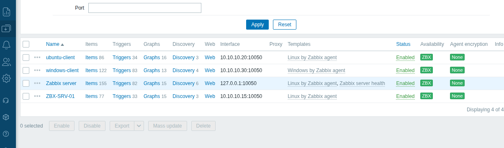
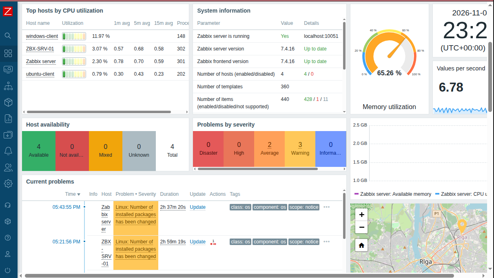
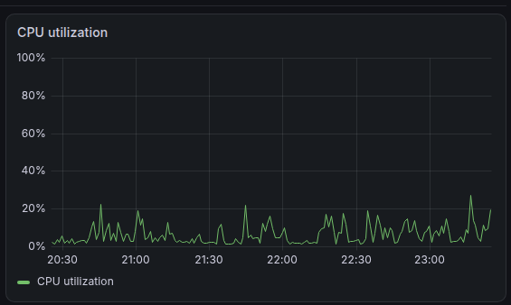
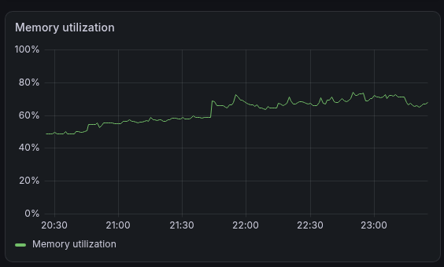
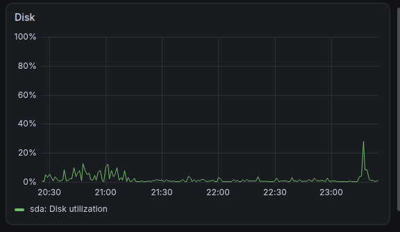
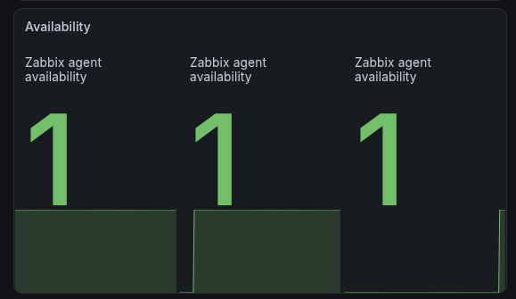
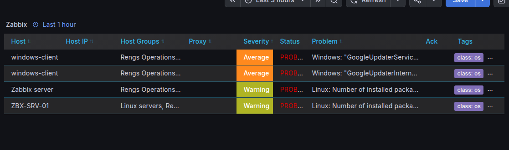
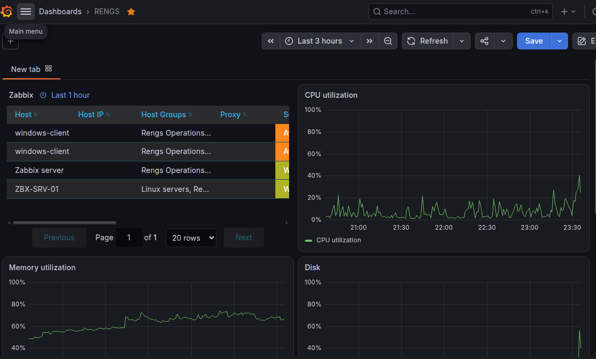

# Rengs Operations NOC — Parte 1

Laboratório prático de monitoramento de infraestrutura, simulando um ambiente de operações de TI da Rengs Operations.

O projeto foi desenvolvido para praticar a configuração de ferramentas de monitoramento, acompanhamento de equipamentos Linux e Windows e visualização de métricas de infraestrutura.

## Objetivo

Construir um ambiente de monitoramento centralizado utilizando Zabbix e Grafana, permitindo acompanhar métricas e a disponibilidade dos equipamentos conectados ao laboratório.

## Ambiente utilizado

| Componente | Configuração |
|---|---|
| Zabbix Server | 7.4 |
| Grafana | Integração com Zabbix |
| Sistema operacional do servidor | Ubuntu Server 24.04 LTS |
| Banco de dados | MariaDB |
| Virtualização | Oracle VirtualBox |
| Agentes | Zabbix Agent e Zabbix Agent 2 |

## Arquitetura do laboratório

| Equipamento | Sistema operacional | Endereço IP |
|---|---|---|
| ZBX-SRV-01 | Ubuntu Server 24.04 | 10.10.10.15 |
| ubuntu-client | Ubuntu | 10.10.10.20 |
| windows-client | Windows 11 | 10.10.10.30 |

## Atividades realizadas

- Instalação e configuração do Zabbix Server.
- Configuração dos agentes Zabbix em Linux e Windows.
- Cadastro e monitoramento dos equipamentos.
- Monitoramento de utilização da CPU.
- Monitoramento de memória.
- Monitoramento de utilização do disco.
- Acompanhamento da disponibilidade dos equipamentos.
- Integração entre Zabbix e Grafana.
- Criação de dashboards para visualização das métricas coletadas.

## Ferramentas utilizadas

- Zabbix
- Grafana
- Ubuntu Server
- Windows 11
- MariaDB
- Oracle VirtualBox

## Capturas de tela

### 1. Zabbix — Hosts monitorados

### 2. Zabbix — Dados recentes

### 3. Grafana — Utilização da CPU

### 4. Grafana — Utilização da memória

### 5. Grafana — Utilização do disco

### 6. Grafana — Disponibilidade

### 7. Grafana — Gráfico do Zabbix

### 8. Grafana — Dashboard Zabbix

## Aprendizados

Durante o desenvolvimento deste laboratório, pratiquei a instalação e configuração das ferramentas, o cadastro de equipamentos, a configuração dos agentes e a integração entre Zabbix e Grafana.

Também trabalhei na identificação e resolução de problemas de configuração e comunicação entre os equipamentos.

## Próximas etapas

Esta é a primeira parte do projeto Rengs Operations NOC. Na próxima etapa, o laboratório será ampliado com testes de falhas, troubleshooting e novas práticas relacionadas à rotina de um NOC.

